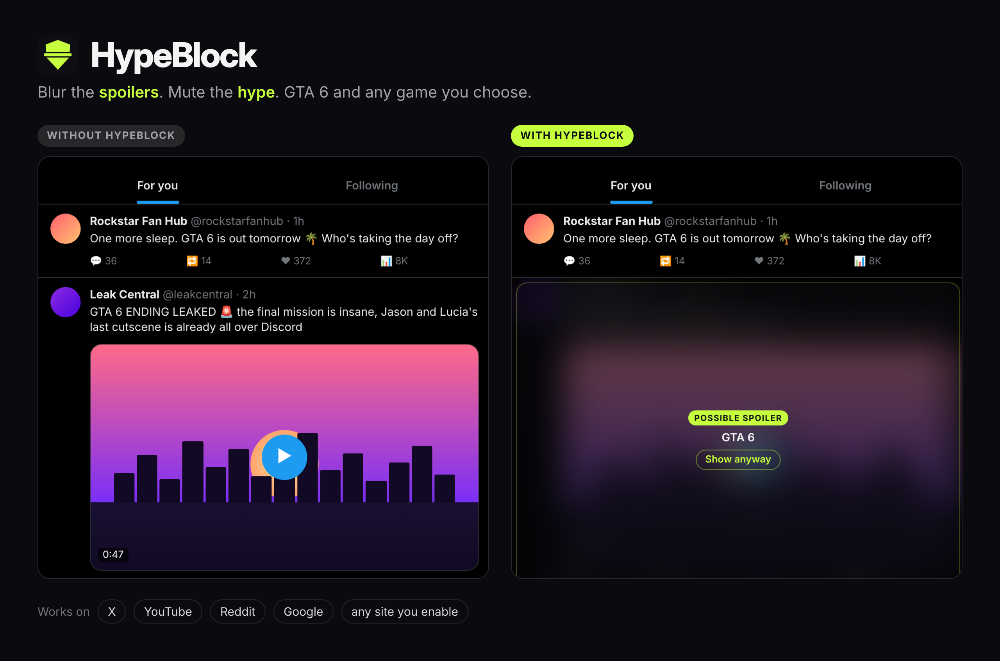
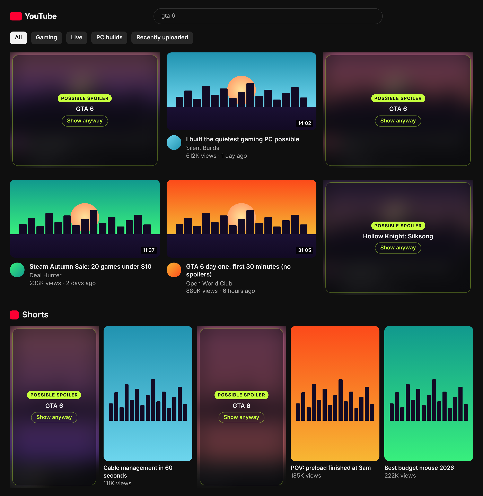
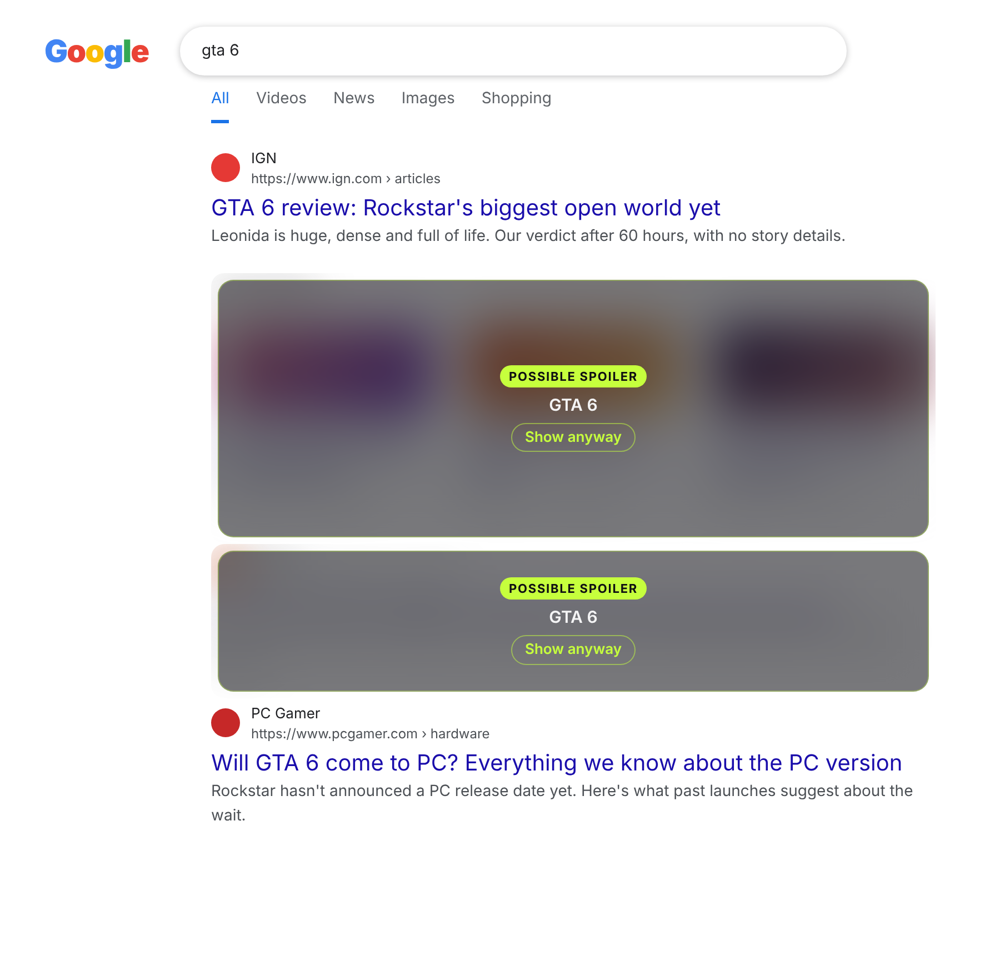
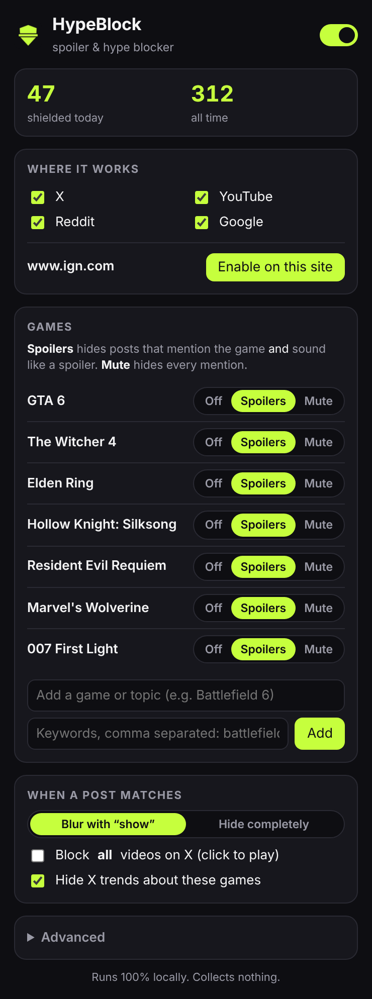

# HypeBlock

**Spoiler & hype blocker for X, YouTube, Reddit, Google and any site you choose.** Blurs game spoilers, mutes the games you're tired of hearing about, and stops spoiler videos from autoplaying.

GTA 6 launches on consoles on November 19, 2026, and the PC version doesn't have a date yet. If you're waiting for PC, or just haven't made it to your console, that's months of endings, twists and "who dies" clips landing in your feeds. And if you're simply sick of GTA 6 taking over every timeline, you can mute it completely.



## What it does

- **Spoiler mode**: hides posts that mention a game *and* look like a spoiler ("ending", "final boss", "leaked", "dies", "twist", "спойлер", "концовка"...). Normal news and memes stay visible.
- **Mute mode**: hides every mention of a game, for when you're done with the hype entirely.
- **Blur or hide**: matched posts are blurred with a "Show anyway" button, or removed from the feed completely.
- **Works across the web**:
  - **X**: posts, quoted posts, link cards, image descriptions, trends
  - **YouTube**: video cards on home, search, sidebar and end screens, Shorts, comments
  - **Reddit**: posts and comments, new and old Reddit
  - **Google**: results, Top stories, video results, "People also ask"
  - **Any other site**: open it, click HypeBlock, press **Enable on this site**. Headlines, paragraphs, list items and pictures (by their description) get covered.
- **Video blocker for X**: optionally covers every video until you click "Play anyway". Videos inside shielded posts never autoplay on any site.
- **Trends cleanup**: removes X trends about the games you've shielded.
- **Your own topics**: add any game, show or keyword list (e.g. `battlefield 6, bf6`).
- **Muted accounts**: silence leakers and hype farms.
- **Smart about "no spoilers"**: titles like "first 30 minutes (no spoilers)" or "spoiler-free review" stay visible.
- **Works with any spelling**: `GTA 6`, `GTA VI`, `#GTA6`, `gta-6`, `Grand Theft Auto VI`, plus Latin and Cyrillic text.

<p>


</p>

Ships with presets for GTA 6, The Witcher 4, Elden Ring, Hollow Knight: Silksong, Resident Evil Requiem, Marvel's Wolverine and 007 First Light.



## Install

### Chrome, Edge, Brave, Opera, Arc, Vivaldi (any Chromium browser)

1. Download `hypeblock-chrome.zip` from [Releases](../../releases) and unzip it, or clone this repo.
2. Open `chrome://extensions` (`edge://extensions`, `brave://extensions`...).
3. Turn on **Developer mode**.
4. Click **Load unpacked** and select the unzipped folder.
5. Open X, YouTube, Reddit or Google.

### Firefox

1. Download `hypeblock-firefox.zip` from [Releases](../../releases).
2. Open `about:debugging#/runtime/this-firefox`, click **Load Temporary Add-on**, and pick the zip (or `manifest.json` from the repo).
3. Click the HypeBlock icon. If it asks, press **Allow**.

Temporary add-ons are removed when Firefox restarts. A permanent install needs the add-on signed through addons.mozilla.org.

## How it works

A content script reads each post, video card or search result as the page loads it. Each site has its own small adapter that knows what counts as one "post" there; on other sites HypeBlock looks at articles, headlines, paragraphs, list items and image descriptions. Text is checked against your topics with whole-word matching, so `gta60` or `bending` never trigger anything. Matches get blurred or hidden before you scroll to them.

Everything runs locally in your browser. No servers, no analytics, no network requests.

Permissions:
- **x.com, youtube.com, reddit.com, google.com**: to read and cover posts there.
- **Other sites**: optional. HypeBlock asks for a site only when you press "Enable on this site", and you can remove it with one click.
- **storage, scripting, activeTab**: settings, the "shielded today" counter, and switching HypeBlock on for the tab you're looking at.

Using Google in another country (google.com.ua, google.de...)? Open it and press **Enable on this site**; HypeBlock uses its Google adapter there.

## Limitations

- Desktop browsers only. Mobile apps can't run extensions.
- It reads text, not pixels. A thumbnail that shows a spoiler without any words in its title or description can slip through.
- It's keyword-based, so a spoiler that never names the game ("can't believe she dies at the end") can slip through. Add character names as keywords if you need tighter coverage.
- On "any site" mode, layouts vary, so covers are less precise than on the built-in sites.
- Sites change their layouts from time to time. If something stops working, open an issue.

## Development

```bash
npm test         # matcher tests (Node 18+)
npm run build    # writes dist/hypeblock-chrome.zip and dist/hypeblock-firefox.zip
```

```
manifest.json       MV3 manifest (Chromium + Firefox)
src/filters.js      topic presets and matching logic (shared with the popup and tests)
src/adapters.js     per-site rules: X, YouTube, Reddit, Google, and the generic fallback
src/content.js      engine: scans units, blurs/hides, guards autoplay
src/background.js   keeps "Enable on this site" registrations in sync
src/content.css     cover and blur styles
popup/              settings UI
tests/              node:test suite
```

## License

MIT
